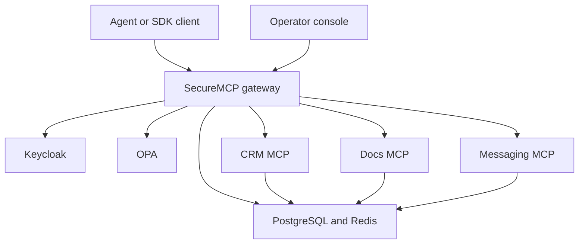
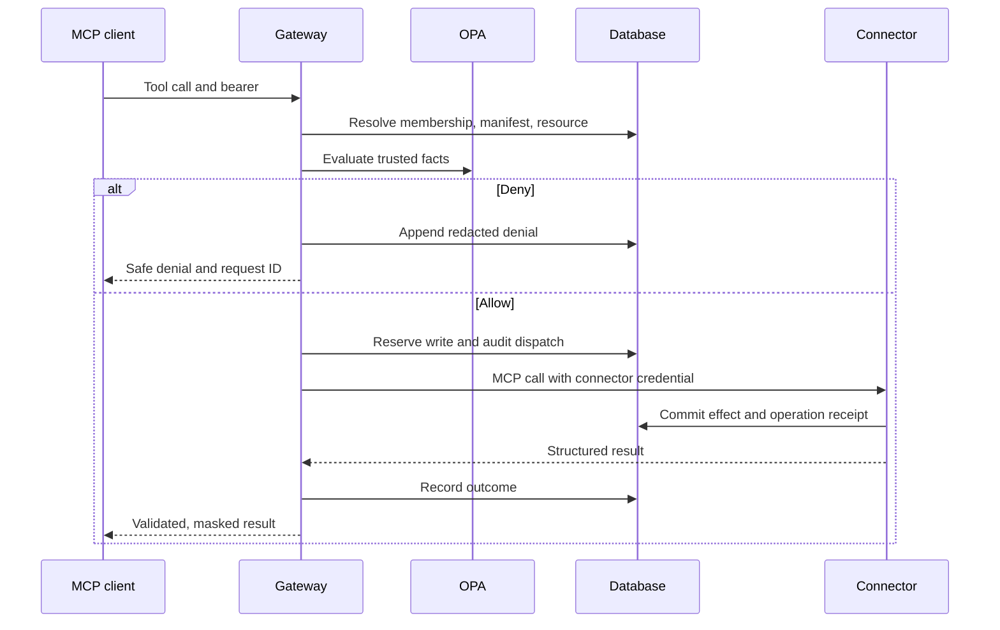

# Architecture

The gateway serves Streamable HTTP at `/mcp`. All protected requests verify their bearer token independently, including legacy MCP traffic. Gateway and connectors use low-level SDK server handlers and official SDK clients. Operators use bearer-authenticated `/api/v1` endpoints. Compose exposes the browser and Keycloak on loopback and keeps upstreams on an internal network. The gateway uses fixed connector IPs, separate connector signing keys and PostgreSQL login roles.

## Execution and denial

An approval request persists the operation digest, review preview, encrypted exact arguments, policy version, manifest fingerprint, and expiry. A separate reviewer records a decision. A retry provides the approval ID in MCP request metadata, reauthenticates the caller, and evaluates current policy before consuming approval and reserving idempotency in a single PostgreSQL transaction. The connector records its operation receipt and the business change atomically.

A simulator replay reads sanitized decision facts and runs the same OPA decision path with two configuration snapshots. The evaluation leaves tools, approvals, and business state alone. A requested saved report adds a simulation row and an audit event.

The attack lab creates a fresh SQLite dataset and signing authority per comparison condition, uses the same tool handlers via ASGI and MCP, and evaluates protected scenarios with the live OPA process. Direct-mode credentials are scoped to the sandbox. PostgreSQL tests independently verify concurrent approval behavior.
