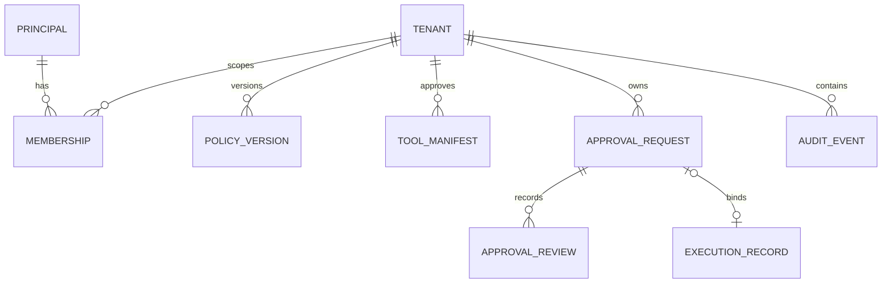

# Data model

Tenant filters apply to connectors, tools, versions, approvals, simulations, runs, and business records. Connector data queries filter tenant again. Policy grants are recorded alongside the bounded configuration. Benchmark results reference a tenant-owned benchmark run. Audit rows use monotonically increasing tenant sequence numbers and chain hashes.

Migration `0001` creates the relational schema and indexes. `0002` introduces encrypted review arguments and an append-only PostgreSQL trigger. `alembic downgrade base` removes the schema from the selected database. Run downgrade against a disposable database only. `python -m securemcp.seed` loads the initial dataset in a transaction when the tenant table is empty. Subsequent runs preserve runtime state.

A write reservation is unique by tenant, principal, tool and operation key. Connector receipts are unique by gateway operation ID. The production application requires service-layer tenant filtering. The schema currently uses ordinary PostgreSQL grants and separate service roles.
